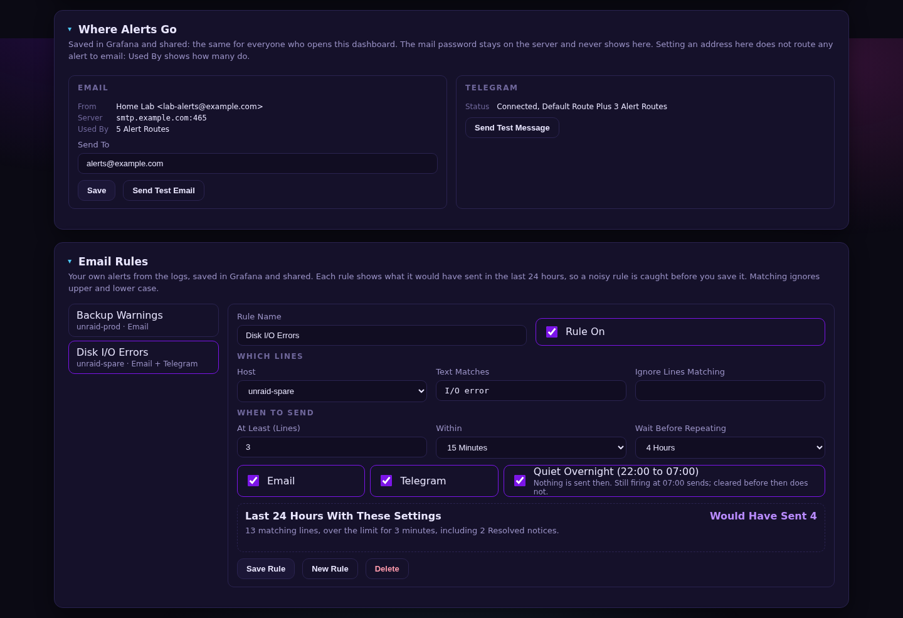
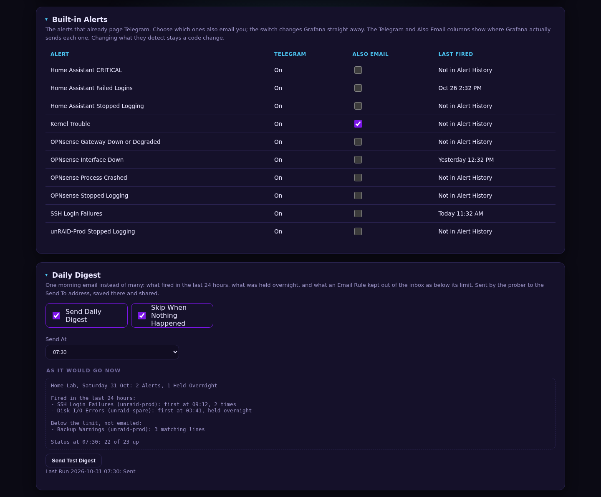
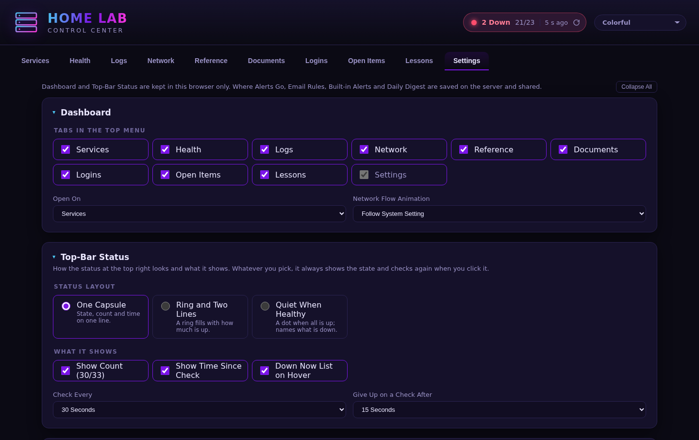
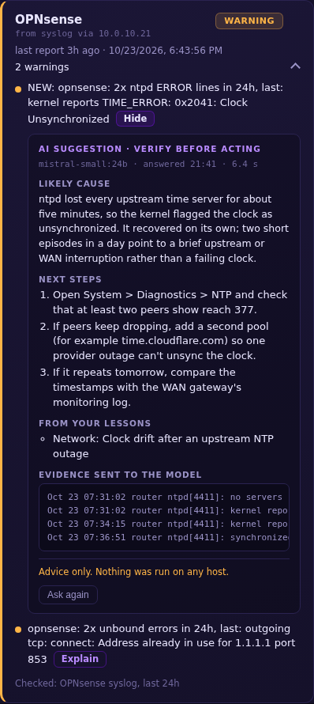

# Home Lab Control

A single dashboard for running a home lab: what's up, what broke overnight, how the network is laid out and how busy each link is, where every container lives, who gets told when something fails, and how to get back in when something goes wrong.

It runs on the lab's own Unraid server, stays on the LAN behind basic auth, and has no cloud dependency.

> **Source code:** not public yet. This page describes what the dashboard does.
> All screenshots use made-up example data. No real hosts, addresses or credentials appear in them.

## What It Does

### Services
Every service in the lab gets a tile, grouped by role (Core, Media, Smart Home, AI, Git & CI, Handoff). Each tile shows whether the service is up, refreshes every 30 seconds, and opens the service's web UI on click. The status at the top right keeps a running count so a problem is visible from any tab. Hovering it lists what is down, why, and for how long, and a click checks again.

Each group folds into a section, and a closed section's header still shows a live count, such as "2 down · 6 up". A section opens by itself while something in it is down and closes again once it recovers. Anything you open or close stays that way in your browser. One **Expand All / Collapse All** toggle at the top of the tab handles every section at once, and Health, Reference and Settings have the same toggle.

Some tiles show live stats as well as up or down. The Ollama tile shows which model is loaded and how much of it sits on the GPU. The GPU tile shows load, VRAM, temperature and power.

### Health
Every morning each Unraid server runs a read-only Daily Health Check and posts its report to the dashboard and to Telegram. A second check reads the router's and Home Assistant's logs from the central syslog collector and reports on those too.

Each host gets a card that is green, amber or red. Problems, warnings and notes are listed in plain language, findings that weren't there yesterday are marked **NEW**, and every card lists what was checked.

A card also turns red if its host hasn't reported for over a day. A host that is down can't report that it's down, so a missing report counts as a problem in itself.

### Logs
Syslog from every server, the router and Home Assistant, collected in one place and kept for 30 days. You can filter by host and app, or search with a regex. Logs are stored in Loki and viewed in Grafana inside the dashboard, behind the same login.

### Network
A topology diagram of the whole network (router, switches, access points, servers) and the VLAN plan as an editable table.

The diagram is live:
- **Status on every box.** A dot shows whether each device answers: green up, red down, grey not checked yet. A cold-standby box is marked as standby, not as an outage.
- **Click for details.** Clicking a box (or tabbing to it and pressing Enter) opens a side panel with its live status, its address and ports, and a link to its web UI.
- **Wires from UniFi.** Each cable is coloured from its switch port on the UniFi controller: green 10 GbE, teal 2.5 GbE, cyan 1 GbE, amber slower, red link down. Hovering a wire shows both ends, the link speed, current traffic, PoE draw and errors. The panel adds what UniFi knows about the device: clients on an access point, ports up on a switch, and the mesh parent of a wireless extender.
- **Traffic flow.** Selecting a box lights its path toward the router, hop by hop through switches and wireless mesh links, and dims everything else. Dashes march along each lit cable, gold for upload and white for download, faster the busier the port. A new reading every 30 seconds only changes a stream's pace when the traffic really changes, so the dashes don't stutter on ordinary jitter.
- **Bonded links.** A LACP bond shows the traffic of all its members, and turns dashed amber ("LACP 1 of 2 up, degraded") when one member drops.
- **Honest when data is missing.** If the controller can't be read, the wires stay as drawn and a note under the diagram says why. If a reading goes stale, or the controller answers with nothing, the last good one stays on screen, marked stale. Error counts say "since boot", because that is what the switch counts.

### Alerts
The alerts that page the phone are set up from the dashboard's Settings tab, saved in Grafana and the same for everyone who opens the page:
- **Where Alerts Go.** The email address alerts go to, with Send Test Email and Send Test Message buttons. The mail password stays on the server and never shows on the page. A Used By count says how many alerts actually route to email, so setting an address never looks like more than it is.
- **Email Rules.** Your own alerts from the logs: pick a host, the text to match and the text to ignore, how many lines within 5 minutes, 15 minutes or 1 hour, how long to wait before repeating, and email, Telegram or both. Quiet Overnight holds a rule from 22:00 to 07:00. Before you save, the rule shows what it would have sent in the last 24 hours, so a noisy rule is caught before it fills the inbox.
- **Built-in Alerts.** The alerts that already page Telegram, each with an Also Email switch. The columns show where Grafana actually sends each one, read back from Grafana, not what the page assumes.
- **Daily Digest.** One morning email instead of many: what fired in the last 24 hours, what was held overnight, and what an Email Rule kept out of the inbox as below its limit. It can skip days when nothing happened, and As It Would Go Now previews the next one.

### Settings
Besides the alerts, Settings holds the per-browser choices: which tabs show in the top menu and which one the dashboard opens on, how the network flow animation behaves (follow the system's reduced-motion setting, always animate, or never), and how the status at the top right looks: one capsule, a ring with two lines, or quiet when healthy, with its count, time since the last check and how often it checks. A theme picker at the top right offers nine colour themes, and the network diagram keeps its own dark canvas and link colours in all of them.

### Reference
The lab's inventory, all of it editable in place:
- Core devices
- UniFi switches and access points
- Port-by-port switch maps
- Each server's network interfaces
- DNS and blocklist versions
- Docker containers and compose stacks

Docker containers are grouped by server, then by VLAN, so you can see at a glance what runs where and on which address. Stopped containers are listed too.

Compose stacks get their own table: which containers each stack owns, whether Unraid's Compose Manager or the command line runs it, whether it starts on boot, and where its files live.

### Documents
A read-only browser for the lab's document share: network drawings, runbooks, PDFs. Click a folder to open it, a file to download it.

### Logins
A link to the self-hosted password vault (Vaultwarden), an index of which accounts exist and where each password is kept, and a step-by-step break-glass procedure for getting in if the owner isn't available.

**No passwords are stored in the dashboard.** The index only says where each one lives in the vault.

### Open Items and Lessons
Open Items is a prioritized follow-up list.

Lessons is a searchable record of things that went wrong and how they were fixed, so the same mistake isn't made twice.

### AI Explain
Every problem, warning and note on the Health tab gets an **Explain** button. Clicking it asks a language model running locally on the lab's own GPU (through Ollama) for the likely cause and the next steps to check. One switch in the Health header turns the feature on or off for the whole page.

How it works:
- **Local only.** The model runs on the lab's GPU. Logs never leave the LAN.
- **Advice, never action.** The model has no tools and can't run commands. Every answer is labelled "AI suggestion · verify before acting" and ends with "Advice only. Nothing was run on any host."
- **Shows its evidence.** When a finding quotes a log line, the matching lines from the last two days are pulled from the log store, given to the model and shown under the answer, so you can check its reasoning against the source.
- **Uses the lab's own history.** Lessons that match the finding are given to the model too, and the answer names them.
- **Plays nicely with other GPU users.** It uses whichever model is already loaded rather than swapping in one of its own. It waits its turn if the GPU is busy, and only one explanation runs at a time.
- **Saves answers.** A finding that comes back the next day, with only its count or timestamp changed, reuses the earlier answer. **Ask again** gets a fresh one.
- **Treats logs as untrusted.** Credentials are scrubbed from every line before the model sees it, and log text is passed as data, never as instructions.
- **Skips stale cards.** Findings on a host that hasn't reported for over a day get no button.

## How It's Built

- **Web:** a static page served by nginx, with no build step and no framework. Editable tables save straight back to the server.
- **API:** a small Python service using only the standard library. It checks each service's status, serves and stores the editable tables, and receives the daily health reports. The tables can only be read or changed through the dashboard itself.
- **Link data:** the same service reads the UniFi controller every 30 seconds for each switch port's link state, speed, traffic and bond membership, and each device's uplink. A slow controller never holds up other readers.
- **Alerts:** Grafana alerting sends to Telegram and email. The dashboard edits contact points, rules and routes through Grafana's API, and the Daily Digest is built by the API service from Grafana's alert history and Loki.
- **GPU stats:** a separate small service reads the GPU through the NVIDIA driver, so the main API needs no GPU access.
- **Logs:** Grafana Alloy ships syslog to Loki, and Grafana shows it inside the Logs tab.
- **AI:** Ollama on a local GPU answers AI Explain requests. The API reads evidence from Loki and sends the model only scrubbed text.
- **Health checks:** read-only scripts on each Unraid server, run daily by Unraid's User Scripts plugin.
- **Deploy:** Docker Compose on Unraid.
  - Merged changes to the page and the compose file deploy automatically.
  - Every change goes through CI and a mandatory review before it merges.

## Security

- LAN only, behind basic auth. Nothing is exposed to the internet.
- No secrets live in the dashboard or its repository. Passwords stay in the vault.
- The editable tables, AI Explain and the link data accept requests only from the dashboard's web server.
- The alert mail password is a file on the server, read by Grafana and the API service; the page only ever shows the sender and the server.
- UniFi is read with a View Only local account. Its login lives in a file on the server, never in the repository.
- Health reports are accepted only from the lab's own servers, and each server can update only its own card.
