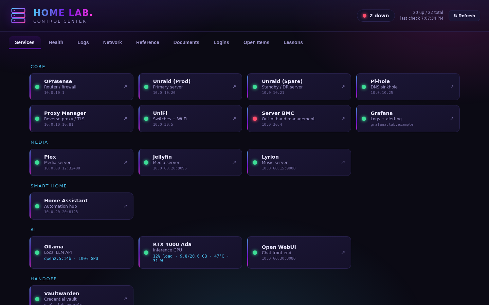
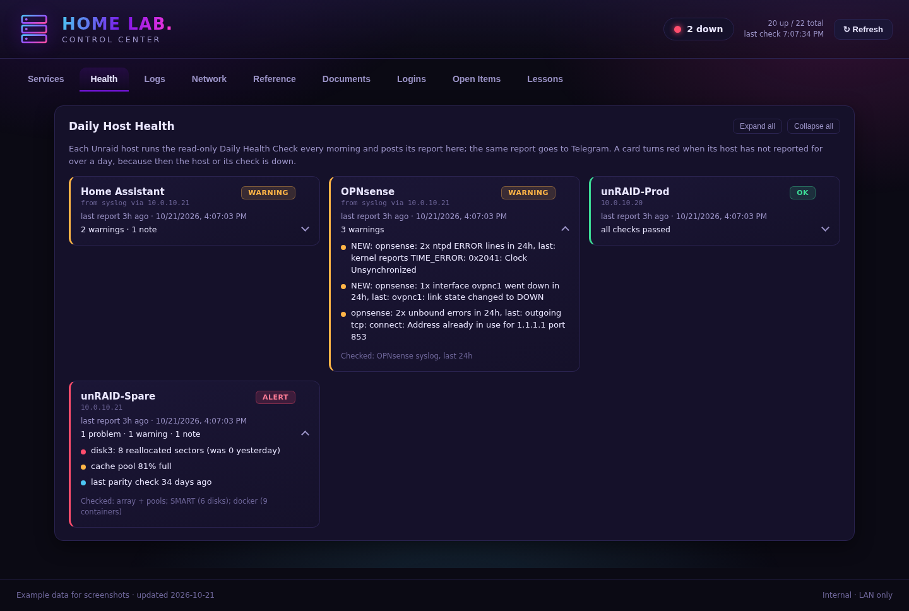
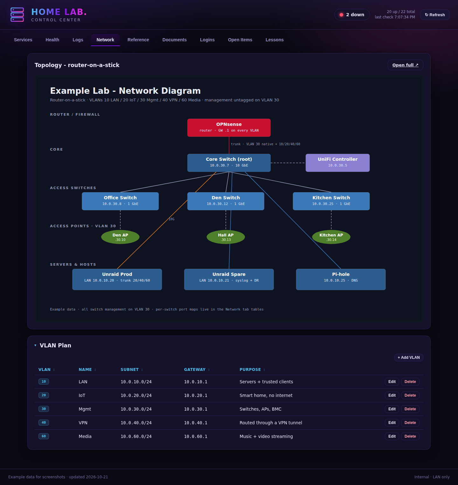
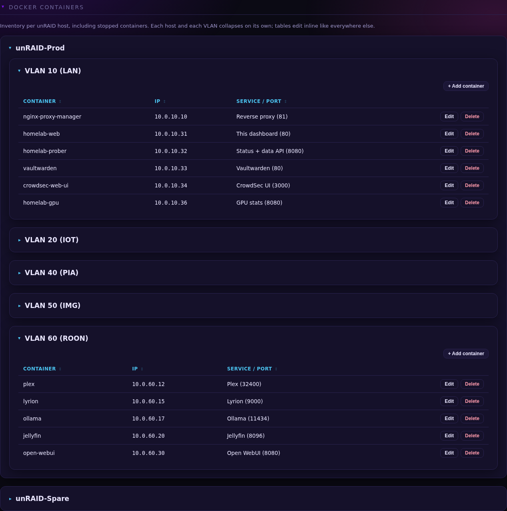
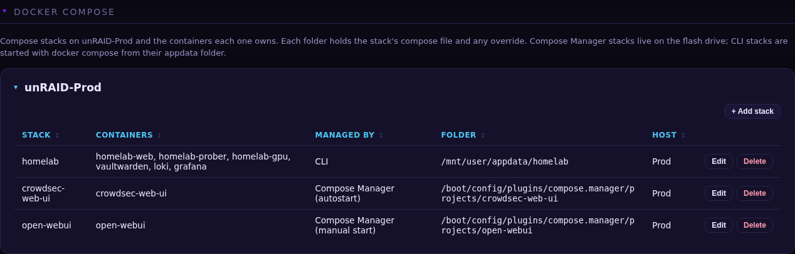
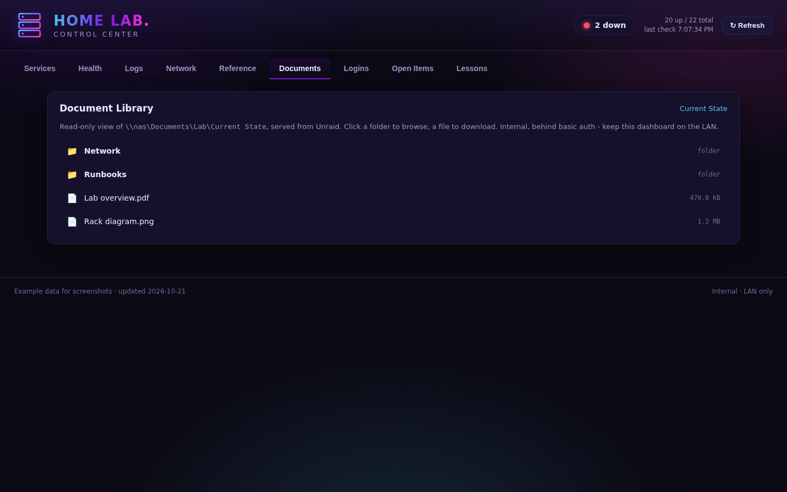
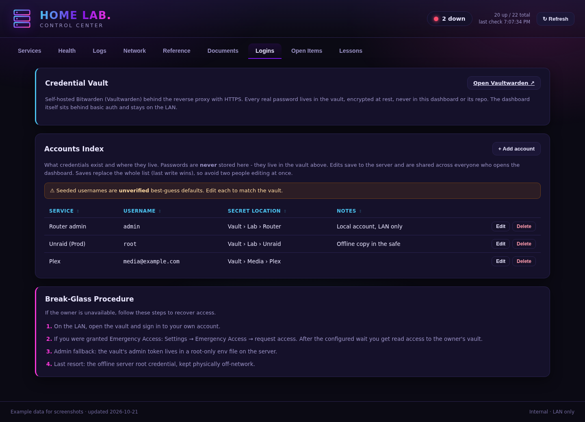
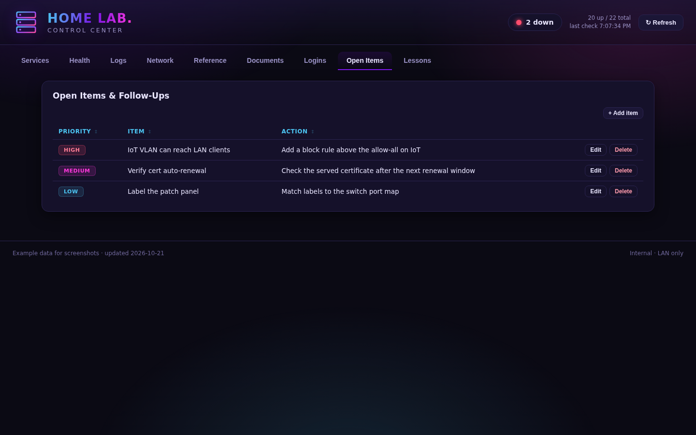
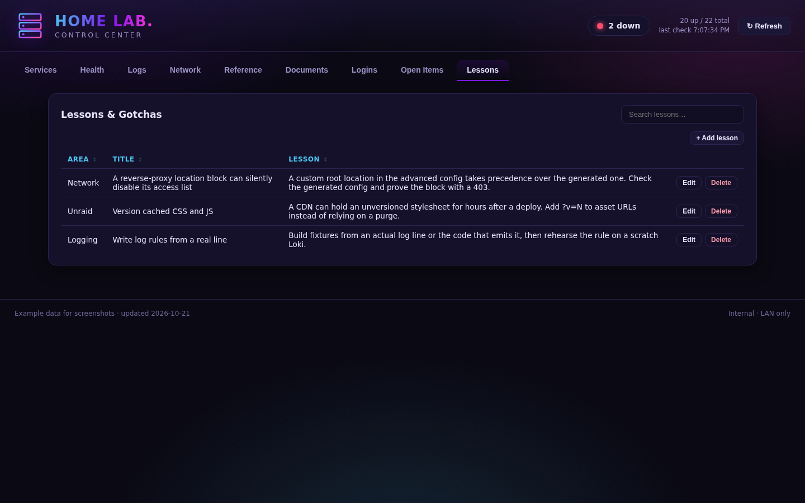
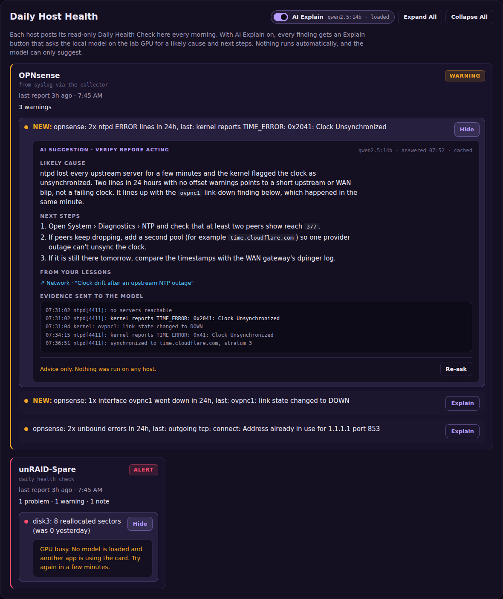

# Home Lab Control

A single dashboard for running a home lab: what's up, what broke overnight, how the network is laid out, where every container lives, and how to get back in when something goes wrong.

It runs on the lab's own Unraid server, stays on the LAN behind basic auth, and has no cloud dependency.

> **Source code:** not public yet. This page describes what the dashboard does.
> All screenshots use made-up example data. No real hosts, addresses or credentials appear in them.

## What It Does

### Services
Every service in the lab gets a tile, grouped by role (Core, Media, Smart Home, AI, Handoff). Each tile shows whether the service is up, refreshes every 30 seconds, and opens the service's web UI on click. The header keeps a running count ("20 up / 22 total") so a problem is visible from any tab.

Some tiles show live stats as well as up or down. The Ollama tile shows which model is loaded and how much of it sits on the GPU. The GPU tile shows load, VRAM, temperature and power.

### Health
Every morning each Unraid server runs a read-only Daily Health Check and posts its report to the dashboard and to Telegram. A second check reads the router's and Home Assistant's logs from the central syslog collector and reports on those too.

Each host gets a card that is green, amber or red. Problems, warnings and notes are listed in plain language, findings that weren't there yesterday are marked **NEW**, and every card lists what was checked.

A card also turns red if its host hasn't reported for over a day. A host that is down can't report that it's down, so a missing report counts as a problem in itself.

### Logs
Syslog from every server, the router and Home Assistant, collected in one place and kept for 30 days. You can filter by host and app, or search with a regex. Logs are stored in Loki and viewed in Grafana inside the dashboard, behind the same login.

### Network
A topology diagram of the whole network (router, switches, access points, servers) and the VLAN plan as an editable table.

### Reference
The lab's inventory, all of it editable in place:
- Core devices
- UniFi switches and access points
- Port-by-port switch maps
- Each server's network interfaces
- DNS and blocklist versions
- Docker containers and compose stacks

Docker containers are grouped by server, then by VLAN, so you can see at a glance what runs where and on which address. Stopped containers are listed too.

Compose stacks get their own table: which containers each stack owns, whether Unraid's Compose Manager or the command line runs it, whether it starts on boot, and where its files live.

### Documents
A read-only browser for the lab's document share: network drawings, runbooks, PDFs. Click a folder to open it, a file to download it.

### Logins
A link to the self-hosted password vault (Vaultwarden), an index of which accounts exist and where each password is kept, and a step-by-step break-glass procedure for getting in if the owner isn't available.

**No passwords are stored in the dashboard.** The index only says where each one lives in the vault.

### Open Items and Lessons
Open Items is a prioritized follow-up list.

Lessons is a searchable record of things that went wrong and how they were fixed, so the same mistake isn't made twice.

## In Development: AI Explain

> **Status:** being built now. The screenshot below is a design preview, not the shipped feature.

AI Explain adds an **Explain** button to every finding on the Health tab. Clicking it asks a language model running locally on the lab's own GPU (through Ollama) for the likely cause and the next steps. One switch turns the feature on or off for the whole page.

How it is designed to work:
- **Local only.** The model runs on the lab's GPU. Logs never leave the LAN.
- **Advice, never action.** The model has no tools and can't run commands. Every answer is labelled "AI suggestion · verify before acting".
- **Shows its evidence.** Each answer lists the log lines it was given, so you can check its reasoning against the source.
- **Uses the lab's own history.** Matching entries from the Lessons tab are passed to the model with the logs, and the answer cites them.
- **Doesn't fight other GPU users.** It uses whatever model is already loaded. If the GPU is busy, it says so instead of waiting in line.
- **Cached.** A finding that repeats the next day reuses its earlier answer.
- **Treats logs as untrusted.** Log text can come from many sources, so it is passed to the model as data, never as instructions.

## How It's Built

- **Web:** a static page served by nginx, with no build step and no framework. Editable tables save straight back to the server.
- **API:** a small Python service using only the standard library. It checks each service's status, serves and stores the editable tables, and receives the daily health reports. The tables can only be read or changed through the dashboard itself.
- **GPU stats:** a separate small service reads the GPU through the NVIDIA driver, so the main API needs no GPU access.
- **Logs:** Grafana Alloy ships syslog to Loki, and Grafana shows it inside the Logs tab.
- **Health checks:** read-only scripts on each Unraid server, run daily by Unraid's User Scripts plugin.
- **Deploy:** Docker Compose on Unraid.
  - Merged changes to the page and the compose file deploy automatically.
  - Every change goes through CI and a mandatory review before it merges.

## Security

- LAN only, behind basic auth. Nothing is exposed to the internet.
- No secrets live in the dashboard or its repository. Passwords stay in the vault.
- The editable tables accept reads and writes only from the dashboard's web server.
- Health reports are accepted only from the lab's own servers, and each server can update only its own card.
